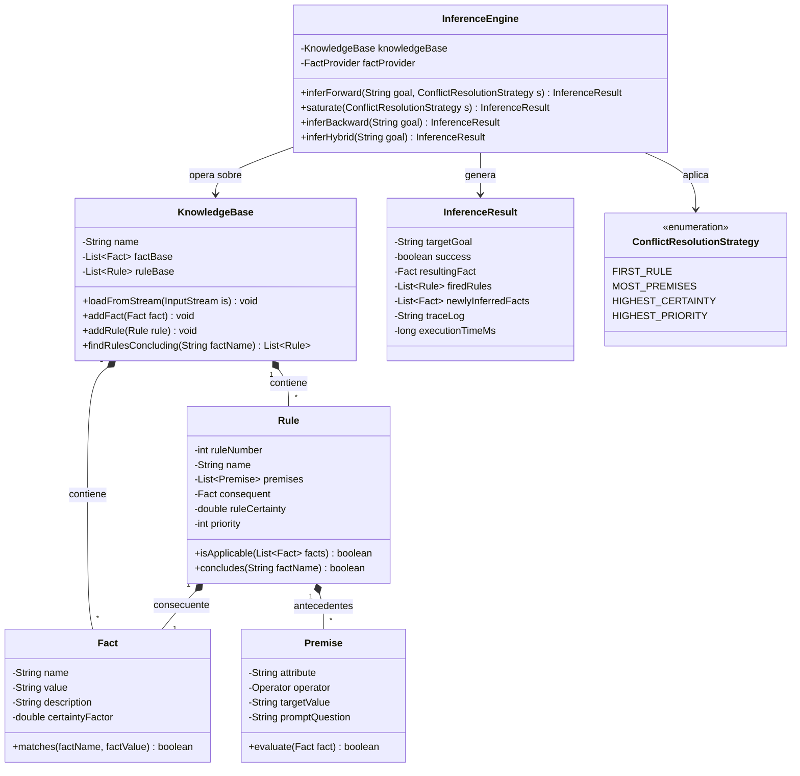

# Universidad Distrital - Expert System & Logic Inference Engine

[](https://github.com/KevinAndrey96/java-udistrital-expert-system-inference-engine/actions)
[](https://www.oracle.com/java/)
[]()
[]()
[](https://www.udistrital.edu.co/)

Motor de inferencia formal y sistema experto desarrollado en **Java**, originado en la carrera de Ingenieria de la **Universidad Distrital Francisco Jose de Caldas** (Bogota D.C., Colombia) para la catedra de Inteligencia Artificial y Sistemas Basados en Conocimiento.

El proyecto implementa los tres paradigmas fundamentales de inferencia logica en inteligencia artificial clasica:
1. **Encadenamiento hacia Adelante (*Forward Chaining* / Guiado por Datos):** Deduccion progresiva hasta alcanzar la meta o llegar al estado de saturacion.
2. **Encadenamiento hacia Atras (*Backward Chaining* / Guiado por Objetivos):** Demostracion recursiva de hipotesis y submetas con deteccion de ciclos y soporte para consultas interactivas.
3. **Encadenamiento Mixto (*Hybrid Chaining*):** Propagacion rapida hacia adelante combinada con validacion hacia atras.
4. **Calculo de Incertidumbre (*Certainty Factors* de Shortliffe / MYCIN):** Cuantificacion formal de la creencia en hechos y reglas en el intervalo $[-1.0, 1.0]$.
5. **Estrategias de Resolucion de Conflictos:** Seleccion determinista por primera regla, mayor especificidad, factor de certeza o prioridad.

Dispone tanto de una interfaz grafica de escritorio en **Java Swing** con la identidad institucional de la Universidad Distrital, como de una **interfaz de linea de comandos (*Headless CLI*)** para pipelines de CI/CD, scripting y contenedores Docker.

---

## Fundamentos Teoricos y Logicos

### 1. Sistema de Produccion

Un sistema de produccion se compone formalmente de tres elementos:
- **Base de Hechos ($BH$):** Conjunto dinamico de proposiciones verdaderas o con cierto grado de creencia que describen el estado actual del mundo:
  $$BH = \{ f_1, f_2, \dots, f_m \}$$
- **Base de Reglas ($BR$):** Conjunto estatico de axiomas o reglas de produccion que representan el conocimiento experto del dominio:
  $$BR = \{ R_1, R_2, \dots, R_k \}$$
- **Motor de Inferencia:** Algoritmo que ejecuta el ciclo de reconocimiento-accion (*match-resolve-act*):

```
       +-----------------------+
       |   Base de Reglas      |
       |  IF P1..Pn THEN C_k   |
       +-----------+-----------+
                   |
                   v
+------------------+------------------+        +-------------------+
|               MOTOR                 | <----> |  Base de Hechos   |
|           DE INFERENCIA             |        |    (Memoria de    |
| (Match -> Resolve -> Act / Explain) |        |      Trabajo)     |
+------------------+------------------+        +-------------------+
                   |
                   v
       +-----------------------+
       |   Traza de Inferencia |
       |   (Explicacion paso a |
       |     paso y certezas)  |
       +-----------------------+
```

### 2. Modus Ponens Generalizado

Cada regla de produccion formaliza una implicacion logica:

$$R_i: P_{i,1} \land P_{i,2} \land \dots \land P_{i,n} \implies C_i$$

Por aplicacion de la regla de inferencia *Modus Ponens*:

$$\frac{P, \quad P \implies Q}{Q}$$

Cuando todos los antecedentes de una regla se satisfacen en la memoria de trabajo, el consecuente $Q$ pasa a formar parte de la Base de Hechos.

### 3. Modelo de Factores de Certeza (MYCIN / Shortliffe)

En presencia de conocimiento imperfecto o probabilistico, el motor implementa el calculo de Shortliffe y Buchanan (1975):

1. **Evaluacion de premisas conjuntivas:**
   $$CF(P_1 \land P_2 \land \dots \land P_n) = \min_{i=1..n} CF(P_i)$$

2. **Propagacion de certeza por regla:**
   $$CF(C) = CF(R) \times CF(\text{Premisas})$$

3. **Combinacion de evidencias independientes para un mismo hecho:**
   $$CF_{comb}(CF_1, CF_2) = \begin{cases} CF_1 + CF_2 - (CF_1 \cdot CF_2) & \text{si } CF_1 \ge 0 \text{ y } CF_2 \ge 0 \\ CF_1 + CF_2 + (CF_1 \cdot CF_2) & \text{si } CF_1 < 0 \text{ y } CF_2 < 0 \\ \frac{CF_1 + CF_2}{1 - \min(|CF_1|, |CF_2|)} & \text{si } CF_1 \cdot CF_2 < 0 \end{cases}$$

---

## Arquitectura del Sistema



---

## Formato del Archivo de Conocimiento (`.kb`)

El motor incluye un parser declarativo para definir bases de conocimiento en texto plano:

```ini
# Prediccion Climatica - Universidad Distrital
FACT SolHoy=1 [CF=1.00]
FACT SolAyer=1 [CF=0.90]
FACT PresionBarometrica=alta [CF=0.85]

# Regla con premisas conjuntivas, factor de certeza y prioridad
RULE R1: IF SolHoy=1 AND SolAyer=1 THEN SolManana=1 [CF=0.95] [PRIORITY=10]
RULE R2: IF PresionBarometrica=alta AND Humedad=baja THEN ClimaEstable=1 [CF=0.90] [PRIORITY=8]
RULE R3: IF SolManana=1 AND ClimaEstable=1 THEN TardeAgradable=1 [CF=0.92] [PRIORITY=7]
```

Bases de conocimiento incluidas en `src/main/resources/kb/`:
- `clima-prediccion.kb`: Prediccion meteorologica con factores de certeza (dominio clasico UD).
- `diagnostico-medico.kb`: Diagnostico sintomatico con combinacion de factores segun MYCIN.
- `clasificacion-animales.kb`: Taxonomia zoologica demostrativa para deduccion en arbol.

---

## Ejecucion por Linea de Comandos (CLI)

### 1. Demostracion Multidominio Integrada
```bash
java -cp target/java-udistrital-expert-system-inference-engine-1.0.0.jar:AbsoluteLayout.jar edu.udistrital.expert.cli.ExpertSystemCli --demo
```

### 2. Encadenamiento hacia Adelante con Archivo `.kb`
```bash
java -cp target/java-udistrital-expert-system-inference-engine-1.0.0.jar:AbsoluteLayout.jar edu.udistrital.expert.cli.ExpertSystemCli \
  --kb src/main/resources/kb/clasificacion-animales.kb \
  --mode forward \
  --goal Especie \
  --strategy premises
```

### 3. Saturacion Completa de la Base de Hechos
```bash
java -cp target/java-udistrital-expert-system-inference-engine-1.0.0.jar:AbsoluteLayout.jar edu.udistrital.expert.cli.ExpertSystemCli \
  --kb src/main/resources/kb/clima-prediccion.kb \
  --mode saturate
```

### 4. Encadenamiento hacia Atras con Hechos Iniciales Inyectados
```bash
java -cp target/java-udistrital-expert-system-inference-engine-1.0.0.jar:AbsoluteLayout.jar edu.udistrital.expert.cli.ExpertSystemCli \
  --kb src/main/resources/kb/diagnostico-medico.kb \
  --mode backward \
  --goal Diagnostico \
  --facts "Fiebre=alta[CF=0.9],Tos=persistente[CF=0.8]"
```

---

## Interfaz Grafica de Usuario (Java Swing)

Para entornos de escritorio con soporte de ventanas:

```bash
java -cp target/java-udistrital-expert-system-inference-engine-1.0.0.jar:AbsoluteLayout.jar edu.udistrital.expert.cli.ExpertSystemCli --gui
```

Caracteristicas de la interfaz Swing:
- Escudo oficial de la **Universidad Distrital Francisco Jose de Caldas**.
- Paneles para definicion interactiva de Hipotesis y Condiciones.
- Botones de accion directa para **Inferir hacia Adelante** e **Inferir hacia Atras**.
- Dialogos de explicacion detallada de la traza de deduccion y porcentaje de certeza final.

---

## Construccion y Pruebas con Maven

```bash
# Compilacion y ejecucion de suite JUnit (17 pruebas unitarias)
mvn clean test

# Empaquetado del JAR ejecutable
mvn package -DskipTests

# Verificacion de arquitectura con script Python (7/7 suites)
python scripts/verify_inference_engine.py
```

---

## Despliegue con Docker y Docker Compose

```bash
# Construir la imagen Docker multi-etapa
docker build -t udistrital-inference-engine .

# Ejecutar demostracion headless dentro del contenedor
docker run --rm udistrital-inference-engine

# O mediante Docker Compose
docker compose up --build
```

---

## Estructura del Repositorio

```
.
|-- Dockerfile
|-- docker-compose.yml
|-- pom.xml
|-- AbsoluteLayout.jar
|-- .github/
|   `-- workflows/
|       `-- ci.yml
|-- scripts/
|   `-- verify_inference_engine.py
`-- src/
    |-- main/
    |   |-- java/
    |   |   |-- Diseño/
    |   |   |   |-- Inicio.java
    |   |   |   `-- Inicio.form
    |   |   |-- Logica/
    |   |   |   |-- Condicion.java
    |   |   |   `-- Hipotesis.java
    |   |   `-- edu/udistrital/expert/
    |   |       |-- cli/
    |   |       |   `-- ExpertSystemCli.java
    |   |       |-- engine/
    |   |       |   |-- CertaintyFactorCalculator.java
    |   |       |   |-- ConflictResolutionStrategy.java
    |   |       |   |-- InferenceEngine.java
    |   |       |   |-- InferenceResult.java
    |   |       `-- model/
    |   |           |-- Fact.java
    |   |           |-- KnowledgeBase.java
    |   |           |-- Premise.java
    |   |           `-- Rule.java
    |   `-- resources/
    |       |-- Imagenes/
    |       |   `-- 200px-Escudo_UD.svg.png
    |       `-- kb/
    |           |-- clasificacion-animales.kb
    |           |-- clima-prediccion.kb
    |           `-- diagnostico-medico.kb
    `-- test/
        `-- java/edu/udistrital/expert/
            |-- BackwardChainingTest.java
            |-- CertaintyFactorTest.java
            |-- ForwardChainingTest.java
            |-- KnowledgeBaseTest.java
```

---

## Creditos y Reconocimientos

- **Universidad Distrital Francisco Jose de Caldas:** Facultad de Ingenieria, Proyecto Curricular de Ingenieria de Sistemas / Inteligencia Artificial.
- **Autores:** Kevin Andrey Martinez Cardenas, Viviana Alvarez, y companeros del curso de Inteligencia Artificial.
- **Licencia:** MIT License.
